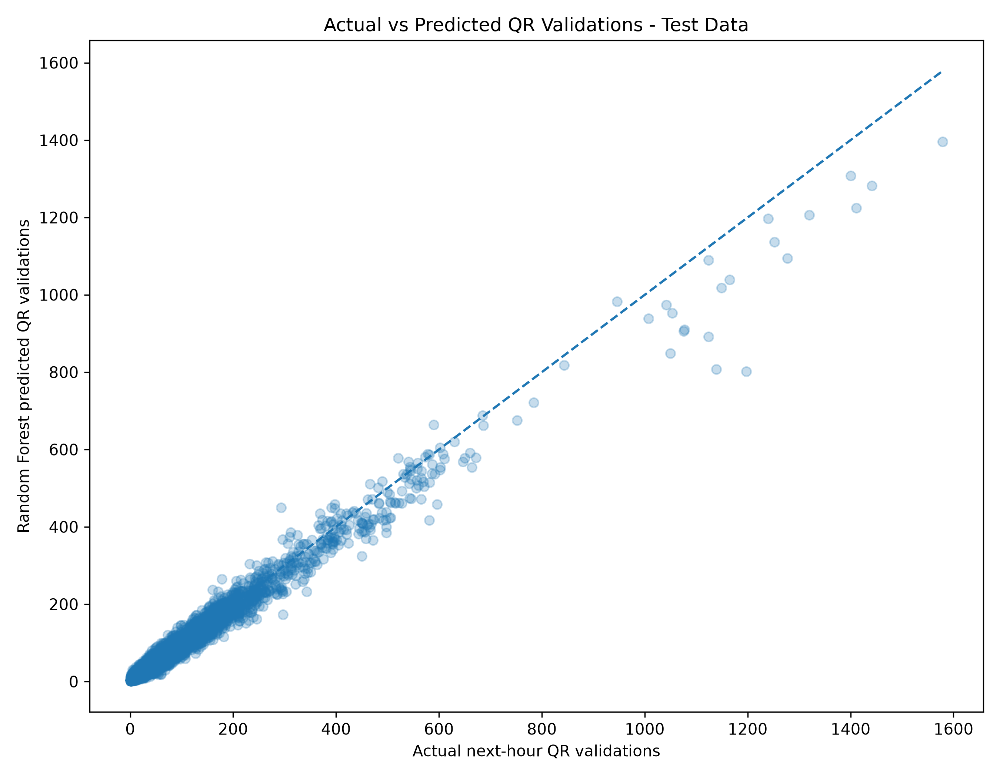
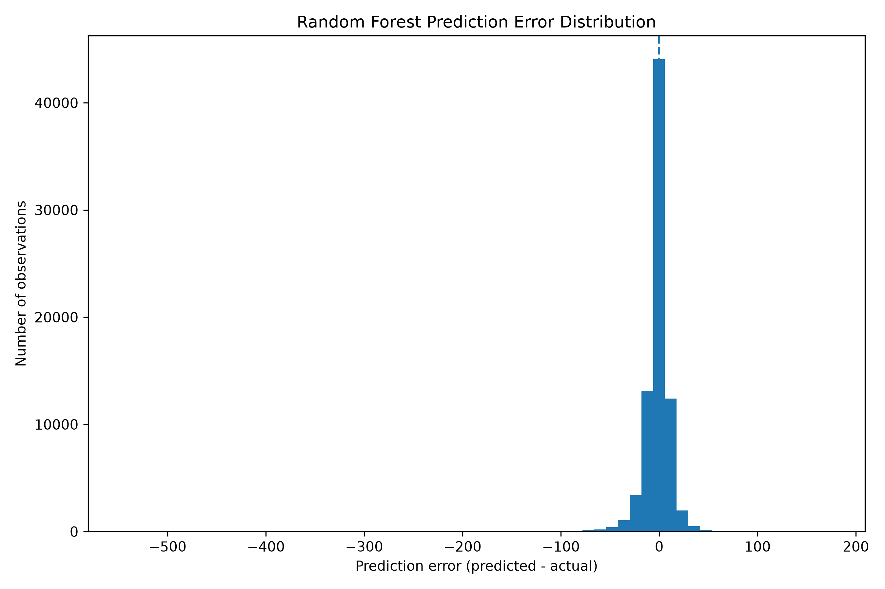
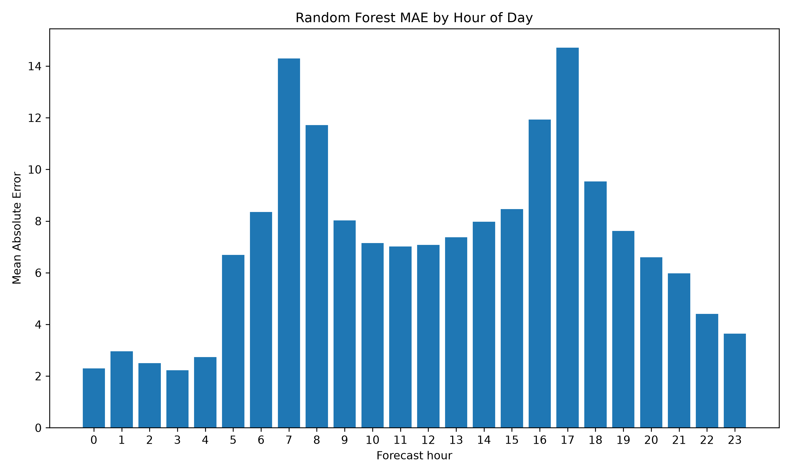
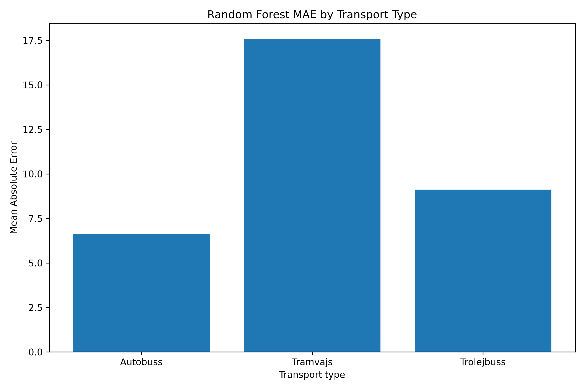

# SmartRoute-Riga

### An Explainable Machine Learning Framework for Short-Term Public Transport Demand Forecasting and Operational Planning in Riga

**An applied machine learning research project using real public transport data from Riga, Latvia.**

---

## Project Overview

SmartRoute-Riga investigates whether historical QR ticket validation activity can be used to forecast QR validations on individual Riga public transport routes one hour ahead.

The project applies a complete machine learning workflow, including data quality assessment, exploratory analysis, time-based feature engineering, supervised regression, chronological model evaluation, feature importance analysis and prediction error investigation.

The research uses publicly available data published by Rīgas Satiksme through the Latvian Open Data Portal.

**Important measurement limitation:** The dataset records QR ticket validations, not every passenger boarding or travelling on public transport. QR validation counts are therefore treated as a proxy for observed validation activity, not as total passenger demand.

## Key Results

The final Random Forest model was evaluated on an untouched test period covering September–October 2026.

| Metric | Random Forest | Persistence Baseline |
|---|---:|---:|
| MAE | **8.44** | 21.97 |
| RMSE | **16.11** | 50.21 |
| R² | **0.9740** | 0.7478 |
| WAPE | **14.72%** | 38.33% |

The Random Forest achieved approximately **61.6% lower MAE** than the persistence baseline on the test period.

These results represent retrospective performance on the available test data. They do not guarantee the same accuracy in future operational conditions.

## Research Question

Can machine learning predict the number of ticket validations on Riga public transport routes in the next hour using historical validation activity, time patterns, route information and transport characteristics?

## Dataset

| Attribute | Description |
|---|---|
| Source | Latvian Open Data Portal |
| Publisher | Rīgas Satiksme |
| Dataset | QR code validation data on Riga public transport vehicles |
| Period | October 2025 – October 2026 |
| Original records | 533,195 |
| Transport modes | Autobuss, Trolejbuss and Tramvajs |
| Licence | CC0 1.0 |

**Official dataset:**  
[QR code validation data – Latvian Open Data Portal](https://data.gov.lv/dati/dataset/kvadrat-kodu-validaciju-dati-rigas-satiksmes-sabiedriskajos-transportlidzeklos)

The original dataset consists of 13 monthly CSV files. The fields include date, hour, transport type, route and validation count.

## Data Preparation and Quality Assessment

The project includes:

1. Combining the 13 monthly source files.
2. Inspecting data types, missing values, duplicate records and invalid values.
3. Auditing route combinations and hourly interval coverage.
4. Examining monthly and daily data completeness.
5. Creating historical features for next-hour forecasting.
6. Excluding a route with insufficient consecutive hourly observations for reliable next-hour modelling.

The resulting modelling dataset contains **499,348 records across 89 transport-route combinations**.

Nine calendar dates in the observed period have no records. These dates were documented rather than automatically treated as days with zero validations.

Route 95 (Autobuss) was excluded from next-hour modelling because it had only four isolated observations and six validations in total. Its original records remain in the source data.

## Methodology

The task is formulated as a supervised regression problem.

The target variable is the number of QR validations in the next hour for a given transport mode and route.

### Feature Engineering

The model uses:

- Current-hour QR validation count.
- Previous-hour validation count.
- Same-hour validation count from the previous day.
- Same-hour validation count from the previous week.
- Hour, day, month and weekend indicators.
- Cyclical time features.
- Transport type and route information.

Historical features are constructed using time-aware alignment to ensure that future observations are not used as inputs for earlier predictions.

### Models Evaluated

Three approaches were compared:

1. **Persistence baseline:** Uses the current observed validation count as the next-hour prediction.
2. **Random Forest Regressor:** An ensemble of decision trees used for nonlinear regression.
3. **Extra Trees Regressor:** An ensemble method evaluated as an alternative tree-based model.

Random Forest was selected based on its lower validation MAE.

### Chronological Evaluation

A chronological split was used instead of random sampling to better represent forecasting on future observations.

| Dataset | Period |
|---|---|
| Training | Before 1 July 2026 |
| Validation | July–August 2026 |
| Testing | September–October 2026 |

The final selected model was refitted using the training and validation periods, then evaluated on the untouched test period.

## Model Performance Visualisations

### Actual vs Predicted Values



This chart compares observed QR validation counts with the model's predictions on the test data.

### Prediction Error Distribution



This visualisation examines the distribution of prediction errors and helps identify the spread of model deviations.

### MAE by Hour



This chart compares model error across different hours of the day.

### MAE by Transport Mode



This chart compares prediction error across buses, trolleybuses and trams.

## Explainability and Error Analysis

Feature importance analysis identified the following important predictive signals:

- Current-hour validation count: approximately 41.9%.
- Same-hour previous-week validation count: approximately 22.5%.
- Same-hour previous-day validation count: approximately 9.6%.
- Previous-hour validation count: approximately 5.4%.

These values describe the model's feature importance, not causal effects.

Additional analysis examined:

- Prediction errors by transport mode.
- Prediction errors by route.
- Model performance by hour.
- Peak and off-peak periods.
- Prediction bias and largest errors.
- Tram route 1 at 17:00, including weekday-level comparisons.

The peak periods used in this project are defined as 07:00–09:59 and 16:00–18:59. This is an analytical assumption for the project, not an official Rīgas Satiksme definition.

The route-level investigation identified underprediction during several weekday 17:00 observations for tram route 1. The sample is limited to the two-month test period, so the finding should be interpreted cautiously rather than as evidence of a specific operational cause.

## Project Structure

```text
SmartRoute-Riga/
│
├── data/
│   ├── raw/
│   │   ├── qr_validacijas_2025_10.csv
│   │   ├── ...
│   │   └── qr_validacijas_2026_10.csv
│   │
│   └── processed/
│       └── Generated datasets (not tracked by Git)
│
├── models/
│   └── best_next_hour_model.joblib
│
├── reports/
│   ├── figures/
│   │   ├── actual_vs_predicted.png
│   │   ├── mae_by_hour.png
│   │   ├── mae_by_transport.png
│   │   └── prediction_error_distribution.png
│   │
│   └── tables/
│       ├── final_test_metrics.csv
│       ├── model_comparison_validation.csv
│       ├── feature_importance.csv
│       ├── error_by_route.csv
│       ├── error_by_transport.csv
│       └── Additional analysis tables
│
├── src/
│   ├── 01_inspect_data.py
│   ├── 02_deep_data_audit.py
│   ├── 03_completeness_audit.py
│   ├── 04_build_model_dataset.py
│   ├── 05_document_route_exclusion.py
│   ├── 06_train_evaluate_models.py
│   ├── 07_model_error_analysis.py
│   └── 08_tram_route_diagnostics.py
│
├── .gitignore
├── README.md
└── requirements.txt
```

## Technologies

- **Python 3.11**
- pandas
- NumPy
- scikit-learn
- Matplotlib
- Seaborn
- joblib
- Git and GitHub

## Reproducibility

Clone the repository:

```bash
git clone https://github.com/Rohith-gargula/SmartRoute-Riga.git
cd SmartRoute-Riga
```

Install the dependencies:

```bash
python -m pip install -r requirements.txt
```

Run the scripts from the project root in numerical order:

```bash
python src/01_inspect_data.py
python src/02_deep_data_audit.py
python src/03_completeness_audit.py
python src/04_build_model_dataset.py
python src/05_document_route_exclusion.py
python src/06_train_evaluate_models.py
python src/07_model_error_analysis.py
python src/08_tram_route_diagnostics.py
```

The original monthly CSV files are included in `data/raw/`.

The scripts generate processed datasets and analysis outputs. The processed CSV datasets are excluded from Git to avoid storing large generated files in the repository.

**Note:** The model training and evaluation script can take several minutes to complete, depending on the computer.

## Limitations and Critical Evaluation

1. **Measurement limitation:** QR validations do not represent all passengers or total passenger demand.
2. **Missing dates:** Nine calendar dates have no records, and missing observations cannot automatically be interpreted as zero activity.
3. **Unexpected events:** Historical patterns may not capture disruptions, special events, weather changes or operational changes.
4. **Generalisation:** Test performance does not guarantee equivalent accuracy in future periods.
5. **Route-level sample size:** The tram route 1 at 17:00 investigation uses a limited two-month test sample.
6. **Feature importance:** Feature importance indicates model reliance, not causal relationships.
7. **Operational deployment:** The project is a retrospective academic research prototype, not a live forecasting or public transport scheduling system.

## Research Purpose

SmartRoute-Riga demonstrates an applied machine learning workflow for public transport analytics. It combines real-world data preparation, data quality assessment, time-based feature engineering, supervised regression, model comparison, explainability and critical evaluation.

The project aims to explore how historical public transport validation patterns can support data-informed operational planning while recognising the limitations of the available data.

---

**Project:** SmartRoute-Riga  
**Focus:** Data Analytics, Machine Learning and Public Transport Forecasting  
**Location:** Riga, Latvia  
**Author:** Rohith Goud Gargula